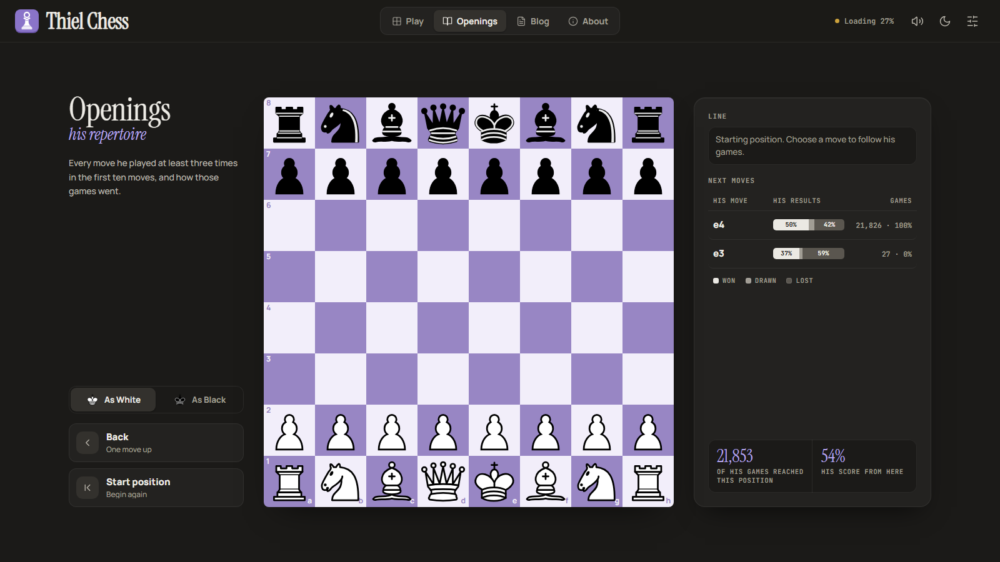
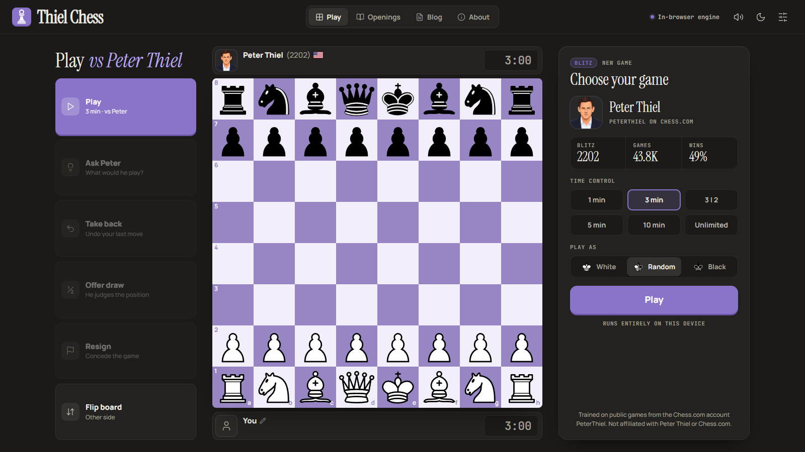

<div align="center">


# Thiel Chess

**Play blitz against a neural network trained to move like the Chess.com player `PeterThiel`.**

It learned from **43,797 of his games** and **1.7 million of his moves**, and predicts his
next move **62.4%** of the time on games it never saw, against 53.2% for the model it
started from. It runs entirely in your browser.

[Live demo](#deploy-to-vercel) · [How it works](docs/architecture.md) · [Data analysis](docs/eda.md) · [Training](training/README.md)



</div>

---

## What's inside

| | |
| --- | --- |
| **Data pipeline** (`pipeline/`) | Downloads every public game from the Chess.com Published-Data API, validates each move, and builds a chronological 90/5/5 train/validation/test split |
| **Exploratory analysis** (`analysis/`, `docs/eda.md`) | Activity, rating, results, game length and the opening repertoire that shapes the model design |
| **Model training** (`training/`) | Fine-tunes [Maia-2](https://github.com/CSSLab/maia2), a human-move-prediction network (ResNet + Elo-aware transformer, 23.3M parameters), on his moves with PyTorch |
| **Export and prediction** (`training/`) | ONNX export checked against PyTorch, and a command-line predictor that needs no GPU |
| **Web app** (`web/`) | Play him at any time control, with Game Review (Stockfish), an Openings explorer, game history, themes and an offline single-file build |

### Features of the web app

- **Plays like him**: his real opening book for the first ten moves, then the fine-tuned
  network; samples moves the way a human would, and thinks for as long as he really did.
- **Game Review** with Stockfish 17.1: every move rated Best to Blunder, accuracy for both
  players, the best move drawn on the board, and Peter's comment on each move.
- **Openings explorer**: walk his repertoire and see how each line scored for him.
- **Your games**: the last 20 games are saved with their review; an all-time record against Peter.
- Ask Peter for a hint, take back, offer a draw (he judges the position), eight board themes,
  dark and light modes, optional name, photo, rating and flag on your player bar.
- **Private by design**: the model runs on your device; nothing is sent to a server.



## Results

Held-out test set: his **newest** 2,190 games (86,415 positions), scored once.

| | Original Maia-2 (blitz) | Fine-tuned on PeterThiel |
| --- | ---: | ---: |
| Top-1 move accuracy | 53.2% | **62.4%** |
| Top-3 move accuracy | 81.3% | **87.6%** |
| Log-loss | 1.445 | **1.118** |
| Opening (ply 1-20) | 47.5% | **77.4%** |
| Middlegame (ply 21-60) | 53.8% | **56.9%** |
| Endgame (ply 61+) | 57.0% | **58.2%** |

The gain is largest in the opening, where he is remarkably consistent: 1.e4 in 99.9% of his
White games and the Sicilian in 99.8% of his replies to 1.e4 ([EDA](docs/eda.md)).

## Quick start

### Play locally

Requires [Node.js](https://nodejs.org/) 20.11 or newer. No install needed to play.

```bash
git clone https://github.com/<your-username>/thiel-chess.git
cd thiel-chess
npm start
```

Open <http://localhost:8080>. You can start playing as soon as his opening book is in (a second or two); the 27 MB model keeps downloading in the background and is cached after the first visit.

### Ask the model from Python

```bash
python -m venv .venv
# Windows: .venv\Scripts\activate      macOS/Linux: source .venv/bin/activate
pip install -r requirements.txt
python training/predict.py --moves e4 c5 Nf3
```

```
rnbqkbnr/pp1ppppp/8/2p5/4P3/5N2/PPPP1PPP/RNBQKB1R b KQkq - 1 2
PeterThiel to move as Black - model's win chance for him: 50%

  1. d6       d7d6   100.0%  ########################################
  2. Nc6      b8c6     0.0%
  3. d5       d7d5     0.0%
  4. g6       g7g6     0.0%
  5. e6       e7e6     0.0%
```

In his main lines the model is near-certain, because he almost always plays the same move;
in unfamiliar positions the probability spreads across several human-plausible moves.

Pass a FEN to analyse any position, `--top N` for more moves, `--json` for machine-readable output.

## Reproduce the whole pipeline

```bash
npm install                                   # chess.js for the data pipeline
npm run data                                  # 1. fetch + 2. clean and split   -> data/
pip install -r requirements.txt
python analysis/eda.py                        # 3. analysis and charts         -> docs/eda/
# 4. training: install PyTorch for your machine first, see training/README.md
pip install -r requirements-train.txt && pip install --no-deps maia2==0.11.0
python training/prepare_data.py               #    encode positions             -> training/cache/
python training/finetune.py --epochs 6 --patience 4
python training/export_onnx.py                # 5. export                      -> web/model/
npm run web:book                              # 6. opening book                -> web/model/book.json
python web/tools/build-timing.py              #    think-time model            -> web/model/timing.json
```

> **Data authorization.** The game records are not included in this repository.
> Chess.com's [User Agreement](https://www.chess.com/legal/user-agreement) requires prior
> written authorization to use its content for training models; obtain it before running
> step 1. See [`data/README.md`](data/README.md) and [`data/DATA_CARD.md`](data/DATA_CARD.md).

Rebuilding from the same raw archive reproduces the dataset byte for byte; compare against
the checksums in `data/manifests/dataset.json`.

## Deploy to Vercel

The site is fully static, so it deploys as-is:

1. Push this repository to GitHub.
2. In Vercel, **Add New → Project**, import the repository and press **Deploy**.
   `vercel.json` already sets everything: no framework, no build, output directory `web`,
   and the cross-origin isolation headers that let the model use several CPU threads.

Or from the command line: `npx vercel --prod`.

Any other static host works too (Netlify, Cloudflare Pages, GitHub Pages); serve the `web/`
folder and, for multi-threaded inference, add the headers
`Cross-Origin-Opener-Policy: same-origin` and `Cross-Origin-Embedder-Policy: require-corp`.
Without them the model runs on one thread, still well under a second per move.

**Offline copy**: `npm install && npm run web:single` writes `web/dist/Thiel Chess.html`, a
single ~68 MB file that opens straight from disk with no server.

## Repository layout

```
├── pipeline/             data collection and cleaning (Node.js)
│   ├── fetch-games.mjs     Chess.com API -> data/raw/
│   ├── build-dataset.mjs   validate, split -> data/processed/ + data/manifests/
│   └── fetch_games.py      dependency-free Python alternative to fetch-games.mjs
├── data/                 README, data card, manifests (game records are git-ignored)
├── analysis/eda.py       exploratory analysis -> docs/eda/
├── training/             Maia-2 fine-tuning (Python)
│   ├── prepare_data.py     encode positions
│   ├── finetune.py         train, evaluate, early stopping -> metrics.json
│   ├── export_onnx.py      ONNX export + parity vectors -> web/
│   └── predict.py          his likely moves for any position
├── web/                  the static web app (HTML/CSS/JS, ONNX Runtime Web, Stockfish)
├── docs/                 architecture, EDA report, screenshots
├── tests/                pipeline tests (Node) and prediction parity tests (Python)
└── vercel.json           static hosting config with cross-origin isolation headers
```

## Tests

```bash
npm test                                   # data pipeline on a two-game sample, shipped files, Vercel config
python -m unittest discover -s tests       # Python predictor vs the exported model's reference vectors
```

In the browser, `/tests/` on the running site checks the JavaScript encoder against the same
reference vectors. GitHub Actions runs the first two on every push (`.github/workflows/ci.yml`).

## Tech stack

**Data**: Node.js, chess.js, Chess.com Published-Data API · **Analysis**: Python, Matplotlib ·
**Model**: PyTorch, Maia-2, python-chess, NumPy · **Export / inference**: ONNX, ONNX Runtime,
ONNX Runtime Web (WebAssembly) · **Web**: HTML, CSS, JavaScript modules, Web Workers, Web Audio ·
**Review engine**: Stockfish 17.1 (WebAssembly) · **Hosting**: any static host (Vercel config included)

## Limitations and responsible use

- This is a **behavioural model of a Chess.com account**, not the person. A username does not
  establish identity, and the project is not affiliated with Peter Thiel or Chess.com.
- Nearly all games are 3-minute blitz, so the model imitates fast decisions, not slow, careful play.
- It sees only the board: no clock pressure, mood or memory of earlier games.
- **Do not use it for assistance in live games** or connect it to a playing account; that
  breaks fair-play rules.

## Credits and license

- [Maia-2](https://github.com/CSSLab/maia2) by the CSSLab, University of Toronto (MIT): the base model.
- [Stockfish](https://stockfishchess.org/) (GPL-3.0), [ONNX Runtime](https://onnxruntime.ai/) (MIT),
  [chess.js](https://github.com/jhlywa/chess.js) (BSD-2-Clause), cburnett pieces, Lucide icons,
  Manrope / Instrument Serif / JetBrains Mono fonts. Full list in [`THIRD_PARTY_NOTICES.md`](THIRD_PARTY_NOTICES.md).

Code by **Mohamed Thoufic**, released under the [MIT License](LICENSE). Bundled third-party
components keep their own licenses.
