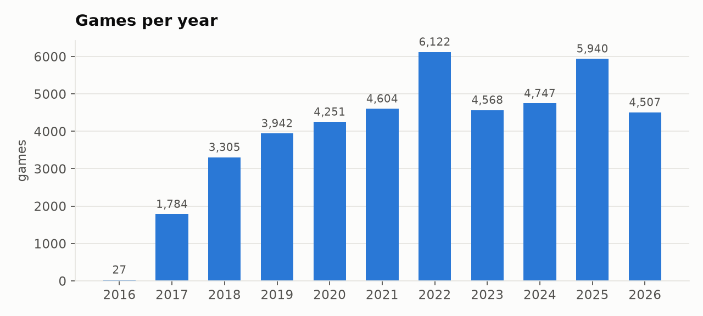
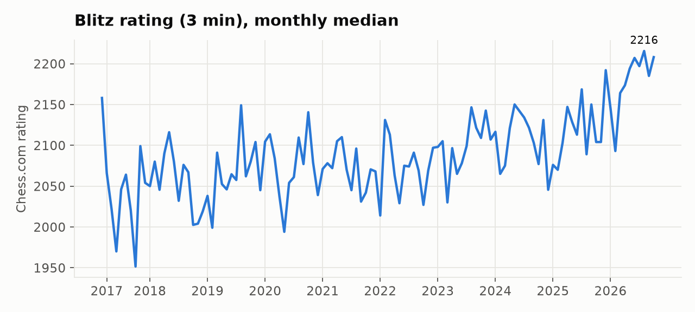
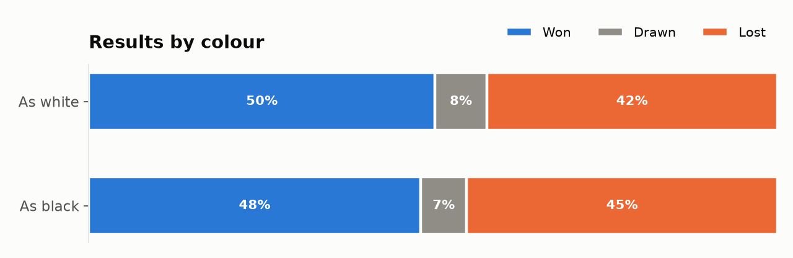
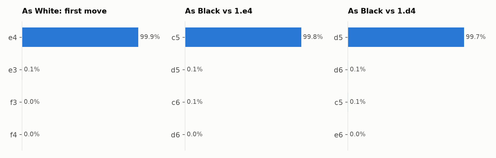
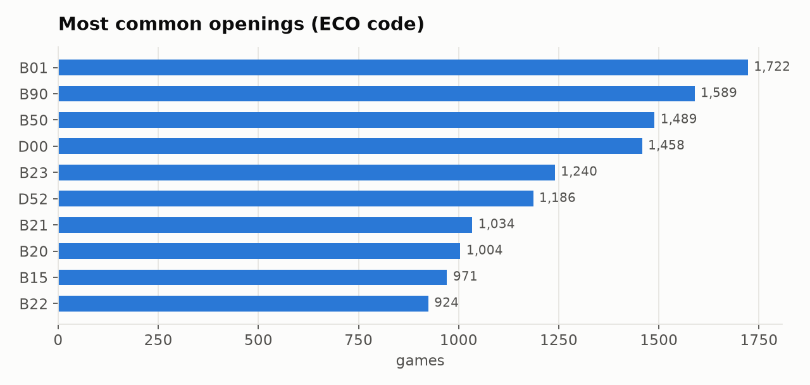
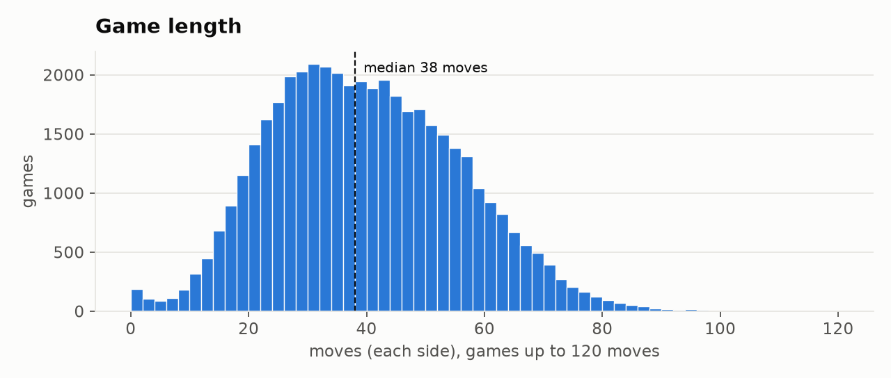

# Exploratory data analysis

Every number and chart here is produced by `analysis/eda.py` from
`data/processed/peterthiel_games.jsonl.gz`; the raw figures are in
[`eda/summary.json`](eda/summary.json). Regenerate with:

```bash
pip install -r requirements.txt
python analysis/eda.py
```

## At a glance

| | |
| --- | --- |
| Games | **43,797** (18 Dec 2016 → 21 Oct 2026) |
| His moves (training examples) | **1,715,752** |
| Time control | **3-minute blitz in 43,786 games** (99.97%); 11 at 10 minutes |
| Rating (3 min) | 1881 → 2308, mean 2093; opponents average 2072 |
| Results | 49.2% won, 7.1% drawn, 43.7% lost |
| Colour | 21,897 as White, 21,900 as Black |
| Median game length | 38 moves (76 plies) |

## Activity



He has played steadily for ten years, peaking at 6,122 games in 2022. The
volume matters for the model: thousands of games a year give dense coverage of
the positions he reaches.

## Rating



His 3-minute rating has drifted upward: a yearly mean of about 2050 in 2017,
2115 in 2025 and 2181 in 2026, with a monthly median peak of 2216. Two
consequences:

- every game sits in Maia-2's top rating bucket (`>= 2000`), so the rating
  input does not distinguish his eras; the fine-tune learns them from data;
- the test split is his newest, strongest play, so test accuracy is measured
  against a slightly moving target (a fair, if harder, test).

## Results



A typical club-blitz profile: he wins half his White games and 48% of his
Black games. Draws are rare (7%), as usual in 3-minute chess.

## Openings: a very narrow repertoire



This is the single most important finding for modelling:

- As White he plays **1.e4 in 99.9%** of games (21,826 of 21,855).
- As Black he answers **1.e4 with the Sicilian (1...c5) 99.8%** of the time,
  and **1.d4 with 1...d5 99.7%** of the time.



The top ECO codes are Sicilian lines (B20-B23, B50, B90 Najdorf) and the
Scandinavian/Queen's Pawn complexes (B01, D00, D52). A player this consistent
is very predictable early on, which is exactly where the fine-tuned model gains
most (opening top-1 accuracy rises from 47.5% to 77.4%; see
[`training/README.md`](../training/README.md)).

## Game length



Games last a median of 38 moves. His decisions split into 434,080 opening
positions (ply 1-20), 763,963 middlegame (21-60) and 517,709 endgame (61+),
so all three phases are well represented in training.

## What this means for the model

1. **Fast-play imitation.** Nearly all games are 3-minute blitz, so the model
   learns his fast decisions, not his slow, careful play. The Maia-2 *blitz*
   checkpoint is the matching starting point.
2. **Opening book.** His repertoire is so concentrated that the web app plays
   the first ten moves from his real game statistics (`web/model/book.json`)
   and hands over to the network afterwards.
3. **Chronological split.** Because his play changes over time, the data is
   split by date (90/5/5), never at random, and every position of a game stays
   in one split.
